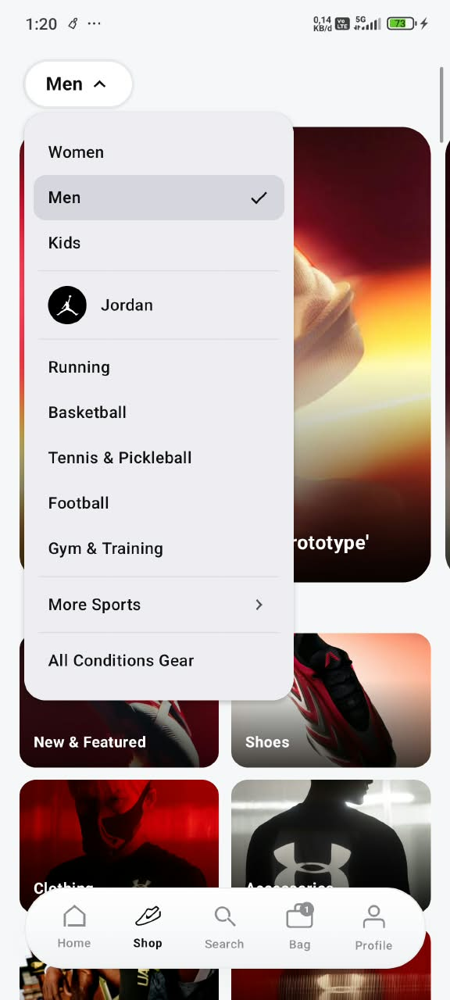
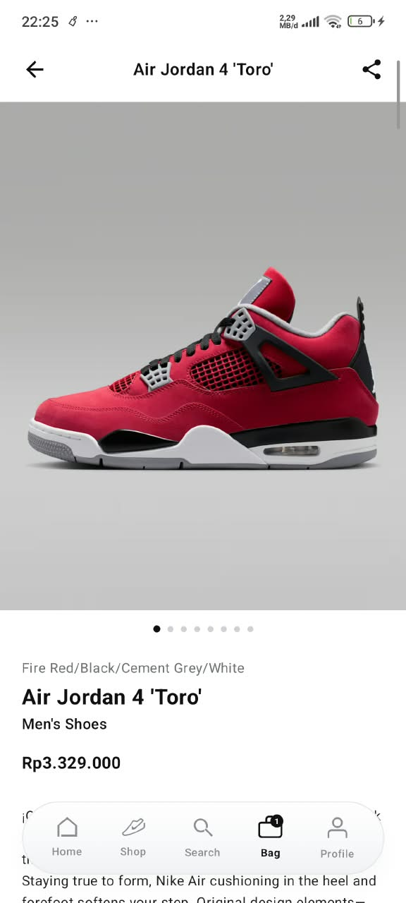
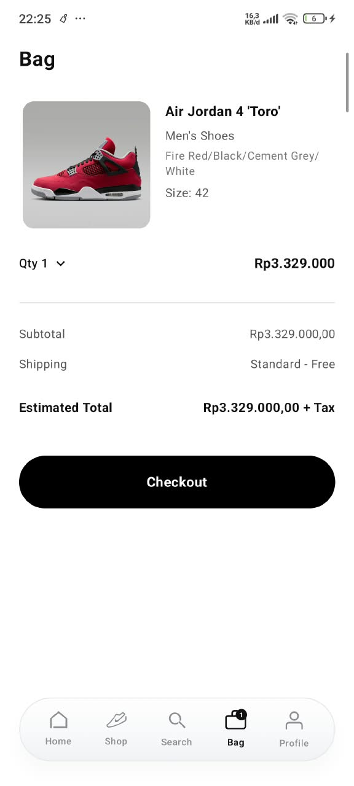

# 🛍️ ShopSey — Elegant E-Commerce Mobile App for Sports and Lifestyle Gear

[](https://r4rdi.github.io/Shopsey-App/)


-orange.svg)

**ShopSey** adalah aplikasi mobile *e-commerce* fesyen dan *lifestyle* bernuansa elegan (Hitam & Putih). Proyek ini dikembangkan sebagai **Tugas Akhir Praktek** untuk mendemonstrasikan implementasi UI/UX yang modern, navigasi yang mulus, dan arsitektur kode yang bersih berbasis Jetpack Compose pada platform Android. 

> [!NOTE]
> **Status Database & Backend:** Proyek ini **belum menggunakan Firebase** maupun database cloud eksternal. Seluruh data (katalog produk, autentikasi OTP, status keranjang, dan profil member) saat ini masih bersifat **Dummy / Mock Data lokal** untuk keperluan simulasi alur antarmuka (UI/UX prototyping).

---


## 🌐 Demo Website Publik (Interactive Web Preview)

Aplikasi ShopSey kini dapat diakses dan dicoba langsung oleh publik melalui browser di desktop maupun smartphone:

👉 **Akses Demo Publik:** [https://r4rdi.github.io/Shopsey-App/](https://r4rdi.github.io/Shopsey-App/)

### 🌟 Fitur Utama Demo Website:
1. **📱 Simulator Smartphone Interaktif:** Menjalankan alur lengkap 16 halaman aplikasi di dalam mockup smartphone (Splash, Landing, Sign In/Up, OTP, Password, Register, Welcome, Home Pager, Shop Catalog, Search, Detail Sepatu, Keranjang, dan Profil).
2. **🔔 Simulasi Notifikasi Sistem OTP:** Pop-up heads-up notification Android realistis di status bar dengan tombol salin kode otomatis.
3. **🌓 Transisi Tema Halus (Dark <-> Light):** Efek mutasi tema dinamis dari Dark Mode pada Home (Vertical Pager 6 brand) ke Light Mode pada Shop & Keranjang.
4. **🖼️ Mode Galeri Tinjauan:** Menampilkan seluruh halaman aplikasi secara berdampingan dalam grid resolusi tinggi untuk kebutuhan presentasi & evaluasi penguji/dosen.
5. **🛒 Simulasi Transaksi:** Pemilih ukuran EU 40 - 47.5, penambahan ke keranjang, kupon diskon SHOPSEY20, hingga modal checkout.

---

## 📸 Tampilan Aplikasi (Screenshots)

| Splash & Home | Kategori Produk | Detail Produk | Keranjang (Cart) |
| :---: | :---: | :---: | :---: |
|  |  |  |  |

---

## ✨ Fitur Utama

### 🎨 UI/UX & Desain
*   **Tema Minimalis & Elegan:** Mengusung skema monokromatik (Hitam solid `#111111` & Putih `#FFFFFF`) untuk menonjolkan foto produk secara premium.
*   **Edge-to-Edge Image Display:** Galeri foto produk (seperti Air Jordan 4 'Toro' & Lifestyle Picks) disesuaikan penuh selebar layar tanpa celah *negative space* atau *background tint mismatch*.
*   **Splash & Welcome Experience:** Animasi logo saat pembukaan serta sambutan visual 3D kolase gambar setelah pengguna berhasil masuk.
*   **Floating Dynamic Bottom Navigation:** Navigasi melayang dengan transisi halus antar tab (Home, Shop, Search, Bag, Profile).

### 🛒 Fungsionalitas E-Commerce (Simulasi Dummy)
*   **Alur Autentikasi Interaktif:** Landing Screen, Sign In/Up via Email, pembuatan Password, serta simulasi pengiriman kode OTP melalui notifikasi sistem Android lokal (*Heads-up Notification*).
*   **Katalog & Mozaik Kategori:** Tampilan multi-kolom Bento Card, carousel *Jump Back In*, dan grid produk 3-kolom pada halaman *Shop*.
*   **Pencarian Interaktif:** Filter instan berdasarkan kata kunci dan kategori populer pada halaman *Search*.
*   **Detail Produk Lengkap:** Galeri multi-sudut (*HorizontalPager*), pemilihan ukuran (EU 40 s/d EU 47.5), deskripsi produk, ulasan *accordion*, dan rekomendasi *You Might Also Like*.
*   **Keranjang Belanja (Bag):** Pengaturan jumlah pesanan (*quantity*), rincian gratis ongkir, ringkasan pembayaran, dan aksi *Checkout*.

---

## 🛠️ Teknologi & Tech Stack

Aplikasi ini dibangun murni secara *Native* untuk Android dengan spesifikasi berikut:

*   **Bahasa Pemrograman:** [Kotlin](https://kotlinlang.org/)
*   **UI Toolkit:** [Jetpack Compose](https://developer.android.com/jetpack/compose) & Material Design 3
*   **Arsitektur Navigasi:** Single-Activity Architecture dengan Android Jetpack Navigation Compose
*   **State Management:** Reactive Compose State (`mutableStateOf`, `remember`, `rememberPagerState`, `rememberScrollState`)
*   **Notifikasi Lokal:** Android NotificationManager & NotificationCompat (untuk simulasi pop-up OTP)
*   **Asset Management:** Pengelolaan gambar beresolusi tinggi dengan `ContentScale.Crop` & `aspectRatio` adaptif

---

## 🚀 Cara Menjalankan Proyek Secara Lokal

Ikuti langkah-langkah berikut untuk menjalankan aplikasi ini di komputer Anda:

### Prasyarat
*   **Android Studio** (Versi Ladybug, Koala, Flamingo, atau versi terbaru).
*   **JDK 17** terkonfigurasi.
*   Emulator Android atau Perangkat Fisik (Minimum Android 8.0 - API 26).

### Instalasi
1.  **Clone repositori ini:**
    ```bash
    git clone https://github.com/r4rdi/ShopSey-App.git
    ```
2.  Buka **Android Studio**.
3.  Pilih **Open** dan pilih direktori folder `ShopSey`.
4.  Tunggu hingga proses **Gradle Sync** selesai sepenuhnya.
5.  Pilih perangkat target (Emulator atau Device fisik yang terhubung via USB Debugging).
6.  Klik tombol ▶️ **Run** (atau tekan `Shift + F10`).

---

## 📂 Struktur Folder Proyek

```text
ShopSey/app/src/main/
├── java/com/example/shopsey/
│   ├── MainActivity.kt        # Single Activity & NavHost Navigasi Lengkap
│   └── ui/
│       ├── splash/            # SplashScreen (Animasi Logo Pembuka)
│       ├── auth/              # Modul Lengkap Autentikasi (Landing, Email, OTP, Password, Register, Welcome)
│       ├── home/              # HomeScreen (Snap Pager Sinematik & Floating Bottom Navigation)
│       ├── shop/              # ShopScreen (Banner Pager, Bento Mosaic Cards, & Lifestyle Picks Grid)
│       ├── search/            # SearchScreen (Pencarian Produk & Kategori Populer)
│       ├── detail/            # ProductDetailScreen (Galeri Edge-to-Edge, Size Picker, & Reviews)
│       ├── bag/               # BagScreen (Keranjang Belanja & Ringkasan Checkout)
│       └── profile/           # ProfileScreen (Profil Pengguna, Manfaat Member, & Pengaturan)
└── res/
    └── drawable/              # Aset Foto Produk, Logo Vektor, dan Cuplikan Layar (Screenshots)
```

---

## 🔮 Rencana Pengembangan (Roadmap)

Karena sistem saat ini masih menggunakan simulasi data tiruan (dummy in-memory), rencana tahapan pengembangan berikutnya meliputi:

- [ ] **Integrasi Database Cloud (Firebase Firestore / Supabase):** Mengganti dummy data lokal dengan database real-time cloud untuk manajemen katalog dan inventaris produk.
- [ ] **Autentikasi Firebase Auth:** Mengintegrasikan login nyata menggunakan nomor telepon/SMS atau Google Sign-In.
- [ ] **Penyimpanan Lokal Persisten (Room Database):** Menyimpan data keranjang (*Bag*) dan *Wishlist* secara offline persisten di perangkat.
- [ ] **Integrasi Payment Gateway:** Menghubungkan proses checkout dengan API pembayaran pihak ketiga (Midtrans/Xendit).

---

## 👨‍💻 Penulis

**Rafi Ardiansyah**

* Mahasiswa Jurusan SIJA di SMK Negeri 2 Yogyakarta
* GitHub: [@r4rdi](https://github.com/r4rdi/ShopSey-App.git)
* LinkedIn: [Rafi Ardiansyah](https://www.linkedin.com/in/rafi-ardiansyah-3935b03b2?utm_source=share_via&utm_content=profile&utm_medium=member_android)
